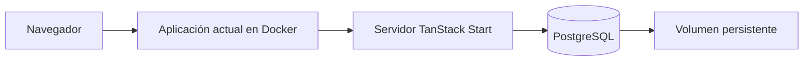

# Plan: ejecutar el sistema con Docker y PostgreSQL

## 1. Objetivo y alcance

Contenerizar Intelli-Stock y conectar sus datos a PostgreSQL, conservando las pantallas, cálculos, recomendaciones y flujos actuales.

Este documento sustituye el plan anterior. No incluye rediseño, refactorización general, autenticación, IA real ni nuevas funciones comerciales. Se conservan las simulaciones y reglas actuales. Los cambios de código se limitarán a ejecutar la aplicación en Docker y leer/guardar datos en PostgreSQL.

**Estado:** Docker y PostgreSQL conectados; productos y decisiones persistidos. Verificación final documentada en la sección 7.

## 2. Qué hay actualmente

- `src/lib/inventory.ts`: 30 productos ficticios y funciones que calculan métricas, historial, forecast y recomendaciones.
- `src/lib/store.tsx`: decisiones guardadas en localStorage y actividad en memoria.
- `src/lib/supervisor.ts`: respuestas mediante reglas locales.
- `src/server.ts` y `src/start.ts`: servidor TanStack Start existente; se aprovechará para acceder a PostgreSQL.
- `vite.config.ts`: configuración Lovable que se ajustará solo si hace falta para ejecutar el servidor en Docker.

En el análisis inicial no existía conexión a base de datos. Después se comprobó el arranque y la compilación originales; el lint original presentó errores de formato. La implementación posterior añade PostgreSQL sin sustituir las fórmulas del prototipo.

## 3. Solución propuesta

Docker Compose tendrá dos servicios permanentes:

| Servicio | Responsabilidad | Acceso |
| --- | --- | --- |
| `app` | Aplicación actual y su servidor | `http://localhost:3000`, publicado en loopback |
| `db` | PostgreSQL | Puerto 5432 interno y 127.0.0.1:5433 en el equipo para pgAdmin |

PostgreSQL usará un volumen nombrado `postgres_data`. La aplicación conectará al hostname `db` mediante variables de entorno; las credenciales permanecerán en el servidor.

Se añadirá una conexión PostgreSQL con consultas parametrizadas y funciones/endpoints de lectura y escritura en el servidor existente. Propuesta mínima: controlador `pg` y migraciones SQL versionadas. No hace falta otra aplicación backend ni un ORM obligatorio.

### Datos que se almacenarán

| Información | Tratamiento |
| --- | --- |
| Productos | Tabla `products` con los campos actuales de BaseProduct: SKU, nombre, categoría, proveedor, precios, stock, límites, ventas7/30, lead time, tendencia y estacionalidad. Carga inicial de los mismos 30 productos. |
| Decisiones | Tabla `decisions` con los campos actuales: id, SKU, nombre, cantidades, costo, estado, motivo, fecha y usuario mostrado. Sustituye localStorage como almacenamiento principal. |
| Métricas y recomendaciones | Se calculan con las mismas funciones, a partir de los productos leídos de PostgreSQL. |
| Historial ficticio y forecast | Se conserva el generador actual; no se convierten en datos históricos reales ni requieren tablas nuevas. |
| Chat y actividad | Permanecen en memoria como actualmente. |

El servidor devolverá datos con la estructura que esperan los componentes actuales. Se adaptará la carga inicial y los consumidores de PRODUCTS/METRICS para que pantallas y Supervisor utilicen el mismo catálogo cargado de PostgreSQL. No basta con crear tablas sin conectar el sistema.

Se conservará useStore en lo posible: guardar una decisión llamará al servidor y actualizará el estado al confirmarse la escritura. Un fallo de lectura o escritura mostrará un mensaje. La validación mínima protegerá el formato de datos sin redefinir reglas de compra.

La identidad fija actual seguirá siendo una etiqueta de demostración, no una cuenta autenticada. El alcance es ejecución local; acceso por LAN o login serían ampliaciones posteriores.

## 4. Fases de implementación

Las fases se ejecutan en orden. El estado actualizado figura en la sección 7.

| Fase | Trabajo y archivos afectados | Criterio de aceptación |
| --- | --- | --- |
| 1. Comprobar ejecución actual | Instalar dependencias con un único gestor y resolución fijada; ejecutar aplicación, build y lint. Revisar package.json, lockfile y configuración SSR. | Pantallas y acciones actuales comprobadas; fallos previos registrados como referencia. |
| 2. Preparar Docker | Crear Dockerfile, compose.yaml, .dockerignore y .env.example; excluir secretos. Ajustar Vite/entrada SSR solo si es necesario. | Aplicación accesible en localhost:3000 y PostgreSQL saludable con volumen persistente. |
| 3. Crear almacenamiento | Añadir conexión, migraciones SQL y semilla explícita para products/decisions. | Base creada desde cero; repetir migraciones/semilla no duplica datos; catálogo inicial idéntico. |
| 4. Conectar el sistema | Añadir lecturas/escrituras servidor; adaptar inventory/store y consumidores según necesidad. | Productos proceden de PostgreSQL; aprobar/modificar/posponer/descartar guardan decisiones que reaparecen al recargar. |
| 5. Verificar y documentar | Comparar comportamiento con referencia y completar README con arranque, variables, migraciones y respaldo. | Mismos flujos y cálculos con los mismos datos; persistencia tras reinicio; instrucciones reproducibles. |

Las migraciones se aplicarán mediante comando o servicio transitorio antes de arrancar app, sin reset automático. Se comprobará que la configuración Lovable permita el runtime local; si necesita ajustes, se limitarán al arranque y compilación.

## 5. Datos existentes y recuperación

Antes de sustituir localStorage, confirmar si hay decisiones que conservar. Si existen, exportarlas desde el navegador y origen donde se registraron: localhost no puede leer automáticamente el almacenamiento del dominio Lovable.

Importarlas conservando identificadores, fechas y cantidades; validar conteos y totales, evitando duplicados al repetir. Si no hay datos que conservar, comenzar con los 30 productos de demostración y decisiones vacías. La semilla no sobrescribirá productos existentes al arrancar.

Conservar versión anterior y exportaciones hasta aceptar el cambio. Si falla Docker, revertir configuración manteniendo volumen. Si PostgreSQL ya recibió decisiones nuevas, respaldarlas y conciliarlas antes de volver atrás; no perderlas restaurando una copia antigua.

Documentar respaldo PostgreSQL y restauración en una base separada. `docker compose down` conserva el volumen; `docker compose down -v` lo elimina y no será el procedimiento normal.

## 6. Comprobaciones finales

- Docker Compose inicia app y PostgreSQL sin instalar PostgreSQL directamente en Windows.
- Catálogo inicial, pantallas, filtros, gráficos, Supervisor, simulador y fórmulas conservan su comportamiento.
- Aprobar, modificar, posponer y descartar funcionan como antes, guardando las decisiones en PostgreSQL.
- El historial conserva sus campos y aparece tras recargar/reiniciar contenedores.
- Un fallo de escritura no se presenta como guardado correcto.
- Migraciones y carga inicial no borran ni duplican información existente.
- README explica variables, arranque, migraciones, respaldo y recuperación.

Se añadieron verificaciones de integración y recorridos automatizados en navegador de las funciones afectadas. Los errores de lógica anteriores ajenos a Docker/persistencia se mantienen fuera de alcance.

## 7. Estimación y seguimiento

Estimación orientativa: **2–4 días de trabajo**, sujeta a comprobar dependencias y runtime SSR. Una importación compleja o integración no incluida en este repositorio puede requerir ajuste.

| Fase | Estado |
| --- | --- |
| 1. Comprobar ejecución | Arranque comprobado por el usuario y build correcto; lint con errores de formato previos. |
| 2. Preparar Docker | Completada: imagen construida, app/db saludables y persistencia del volumen verificada. |
| 3. Crear almacenamiento | Completada: products, decisions, migraciones SQL y semilla inicial sin sobrescritura. |
| 4. Conectar el sistema | Completada: catálogo y decisiones PostgreSQL, confirmación de escritura e importación legacy. |
| 5. Verificar y documentar | Completada: siete pruebas de navegador correctas sobre las imágenes finales, paridad de cálculos, tipos y recuperación comprobados. |

El historial anterior del navegador no se eliminó ni se importó automáticamente. Historial permite importar desde ese navegador o un archivo JSON y conservar una copia original. Los datos de otros orígenes requieren exportación desde su navegador/origen.

### Evidencia de Docker

- `docker compose config --quiet`: correcto.
- `docker compose build`: instalación con npm ci y compilación Nitro node-server correctas en Linux.
- `docker compose up -d --wait`: app y db saludables en localhost:3000.
- Once rutas de aplicación responden HTTP 200 y SKU inexistente responde 404. Se automatizaron interacciones en navegador dentro de Docker.
- Consulta real a PostgreSQL 17.11 correcta. Un marcador en un esquema de prueba sobrevivió a recrear el contenedor db; el esquema se eliminó después de comprobarlo.
- Se crearon products y decisions mediante 001_products_decisions.sql. La app obtiene el catálogo desde PostgreSQL; se cargaron los 30 productos originales y se mantienen las reglas actuales de pendientes/estados.
- La semilla solo carga un catálogo vacío. Repetir inicialización no cambia productos existentes ni duplica datos.
- npm test y typecheck correctos; los 30 resultados completos también se compararon desde filas PostgreSQL contra la referencia original, incluyendo series y recomendaciones.
- Las pruebas de navegador cubren las cuatro decisiones, aprobación desde ficha y Supervisor, errores/reintentos, importación sin duplicados, rollback de lote inválido, validación de origen/datos y persistencia tras recrear contenedores.
- Lint de los archivos de integración: cero errores y dos avisos de Fast Refresh en el contexto React. No se reformateó todo el código de plantilla restante.
- Antes de migrar se guardó un dump principal en backups/ (ignorado por Git). Se restauró un dump del entorno de pruebas en una base temporal, comprobando 30 productos y la migración; la base temporal se retiró.
- Las pruebas se ejecutan en el proyecto inventory-oracle-bot-test, puerto 3001 y volumen propio; sus datos no se mezclan con el entorno principal.
- `.env` local generado con contraseña aleatoria, excluido de Git y del contexto de construcción.

**Uso:** abrir localhost:3000 y, si existe historial previo que conservar, importarlo desde Historial. No se incorporaron autenticación, IA real ni órdenes de compra externas.
